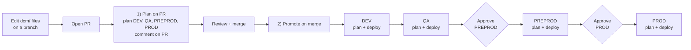

# Snowflake DCM Projects POC

A proof of concept for replacing versioned **schemachange** migrations with
**Snowflake DCM Projects**: declarative definitions, a reviewed plan, and
automated promotion through **DEV → QA → PREPROD → PROD** with GitHub Actions.

It mirrors an enterprise data-platform layout (landing / curated / datamart
layers per environment) and includes the case that previously ruled DCM out:
a **Python stored procedure that calls an external API** (the US Census Bureau
ACS API).

## Why DCM instead of versioned scripts

| Pain with V-numbered scripts | How DCM handles it |
|---|---|
| Must track which `V*` ran in which environment | No versions. Each deploy compares the code to what exists and applies the difference. |
| Editing a deployed `V2` silently does nothing (or fails the checksum) | You edit the definition itself. The next plan shows the ALTER. |
| Two people both create `V2` | No numbers to collide. Normal Git merges. |
| Rerunning an old script to "roll back" doesn't undo anything | Revert the commit; the plan shows the ALTERs back to the old state. |
| Hand changes in an environment go unnoticed | The plan shows drift: anything that no longer matches the code. |
| No preview before PROD | Every PR gets a plan comment per environment (CREATE / ALTER / DROP). |
| Accidental table drops | Deploy is blocked if the plan contains a DROP of a database, schema, table or stage, unless explicitly allowed. |

## How it works



Authentication is **GitHub OIDC**: there are no passwords, keys or secrets in
the repo or in GitHub settings. Snowflake trusts a GitHub identity token only
when it comes from this repo *and* the matching GitHub Environment.

## Repository layout

```
dcm/
  manifest.yml                    targets (DEV/QA/PREPROD/PROD) + per-environment variables
  sources/definitions/
    00_infrastructure.sql         warehouse, LANDING / CURATED / DATAMART databases, schemas
    10_landing_acs.sql            raw table, file format, stage, Python Census API procedure
    20_curated_acs.sql            curated tables, SQL MERGE transform procedure
    25_curated_acs_quality.sql    data-quality results table + Python check procedure
    30_datamart_acs.sql           consumer view
    40_tasks.sql                  monthly task graph (load -> transform), deployed suspended
    90_access.sql                 reader role + grants
  post_deploy/
    01_seed_reference.sql         idempotent seed data, runs after every deploy
.github/workflows/
  0-test-connections.yml          manual: verify OIDC login for every target
  1-plan-on-pr.yml                PR: plan all environments, comment on the PR
  2-promote-on-merge.yml          merge to main: DEV -> QA -> PREPROD -> PROD
  3-deploy-one-env.yml            manual: deploy one environment (drift fix, rollback, drops)
  4-run-acs-load.yml              manual: Census load + transform + quality checks in one environment
  _dcm-deploy.yml                 reusable plan + deploy job used by 2) and 3)
setup/
  01_admin_setup.sql              one-time Snowflake admin setup
  99_teardown.sql                 remove everything
docs/
  demo-script.md                  step-by-step walkthrough for presenting the POC
```

Objects created per environment (`<ENV>` = DEV, QA, PREPROD, PROD):

| Object | Name |
|---|---|
| Warehouse | `POC_<ENV>_WH` |
| Databases | `POC_<ENV>_LANDING`, `POC_<ENV>_CURATED`, `POC_<ENV>_DATAMART` (schema `EDP_ACS` in each) |
| Python procedure (Census API) | `POC_<ENV>_LANDING.EDP_ACS.SP_LOAD_ACS_FROM_API(year)` |
| SQL procedure (transform) | `POC_<ENV>_CURATED.EDP_ACS.SP_TRANSFORM_ACS()` |
| Python procedure (data quality) | `POC_<ENV>_CURATED.EDP_ACS.SP_CHECK_ACS_QUALITY(year)` |
| View | `POC_<ENV>_DATAMART.EDP_ACS.V_COUNTY_PROFILE` |
| Role | `POC_<ENV>_READER` |
| DCM project | `DCM_ADMIN.PROJECTS.EDP_POC_<ENV>` |

## Setup (one time, about 15 minutes)

### 1. Snowflake: run the admin script

First get a free Census API key at
<https://api.census.gov/data/key_signup.html> (it arrives by email in a
minute or two).

In a Snowflake worksheet, as `ACCOUNTADMIN`, open
[`setup/01_admin_setup.sql`](setup/01_admin_setup.sql), paste the key in place
of `PASTE_YOUR_CENSUS_API_KEY_HERE`, and run the whole script. It creates the
`DCM_ADMIN` home, the API-key secret and external access integration for the
Census API, and one deployer role plus one OIDC service user per environment.
The key lives only in Snowflake, never in Git.

Copy the value returned by its last query (for example `ABCDEFG-XY12345`).

### 2. Repo: set the account identifier

In [`dcm/manifest.yml`](dcm/manifest.yml), replace `YOURORG-YOURACCOUNT`
(four places) with that value. Commit straight to `main`.

### 3. GitHub: create the environments

**Settings → Environments → New environment**, create six:

| Environment | Purpose | Settings |
|---|---|---|
| `DCM_DEV` | Snowflake login for DEV | none |
| `DCM_QA` | Snowflake login for QA | none |
| `DCM_PREPROD` | Snowflake login for PREPROD | none |
| `DCM_PROD` | Snowflake login for PROD | none |
| `APPROVE_PREPROD` | approval gate | **Required reviewers**: you |
| `APPROVE_PROD` | approval gate | **Required reviewers**: you |

Names are case-sensitive and must match exactly; they are part of the OIDC
trust in step 1.

> Required reviewers need a public repo or a paid GitHub plan. On a free
> private repo the approval jobs still run, they just don't pause.

Also set **Settings → Actions → General → Workflow permissions** to
**Read and write permissions** (so the workflows can comment plans on PRs).

### 4. Test

**Actions → "0) Test connections" → Run workflow.** All four targets should
pass. The first PR or merge then creates the four DCM projects automatically.

### 5. First deploy

Run **"3) Deploy one environment"** for `DCM_DEV` (or make any small change to
`dcm/` through a PR and merge it to promote all four). Then run
**"4) Run ACS load"** for `DCM_DEV` and check the output table in the job log.

See [`docs/demo-script.md`](docs/demo-script.md) for the full walkthrough.

## Day-to-day

| You want to | Do this |
|---|---|
| Add a column, change a procedure, add a view | Edit the definition in `dcm/sources/definitions/`, open a PR, read the plan comments, merge. |
| Change a value per environment | Edit `templating` in `manifest.yml`. |
| Load seed / reference data | Add an idempotent (`MERGE`) script to `dcm/post_deploy/`. |
| Run the pipeline | Workflow **4)**, or set `task_state: "STARTED"` for that environment to schedule it. |
| Roll back | `git revert` the change, open a PR, merge. The plan shows exactly what reverts. |
| Fix an environment someone changed by hand | Workflow **3)** for that environment. The plan shows the drift first. |
| Intentionally drop a table | Workflow **3)** with **allow_drops** ticked, after reviewing the plan. |

## What DCM does not do (worth knowing before adopting)

- **It manages structure, not data.** `COPY INTO`, `CALL`s and backfills stay
  operational steps (post-deploy scripts, tasks, or a run workflow). A rollback
  restores structure; lost rows come back only through Time Travel.
- **Plan checks that a procedure can be created, not that it runs correctly.**
  Python and SQL procedure bodies are compiled at run time, so test them by
  running them (workflow 4) in DEV/QA.
- **External access integrations are not yet a DEFINE type**, so the
  integration and API-key secret for the Census API are created once in
  `setup/01_admin_setup.sql`.
  The Python procedure that uses it *is* managed by DCM.
- **Some table changes aren't in-place alters**: incompatible column type
  changes and column reordering aren't supported. Those still need a planned
  migration (for example a new column, backfill, then drop the old one).
- **Changes made by hand show up as drift** and are reverted on the next deploy
  unless you put them in the code.

## Adapting for a team repo

- **Separate accounts per environment:** set a different `account_identifier`
  per target; nothing else changes.
- **Restrict who can deploy PROD:** in the `DCM_PROD` environment, limit
  deployment branches to `main` (then plan PROD from `main` only, not from PRs).
- **Password/key-pair instead of OIDC:** supported by the same actions; see the
  [DCM GitHub Actions README](https://github.com/snowflakedb/snowflake-actions/blob/main/dcm/README.md#authentication).

## References

- [DCM Projects overview](https://docs.snowflake.com/en/user-guide/dcm-projects/dcm-projects-overview)
- [Supported entities in DCM Projects](https://docs.snowflake.com/en/user-guide/dcm-projects/dcm-projects-supported-entities)
- [Snowflake DCM GitHub Actions](https://github.com/snowflakedb/snowflake-actions/tree/main/dcm)
- [Snowflake-Labs DCM samples](https://github.com/Snowflake-Labs/snowflake-dcm-projects)
- [Census ACS 5-year API](https://www.census.gov/data/developers/data-sets/acs-5year.html)
